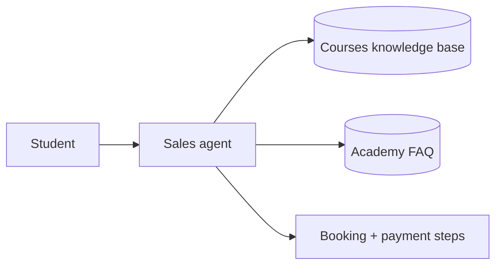

# A Sales Assistant for a Training Academy, in Egyptian Arabic

Course dates, branch locations, booking and payment, answered the way the academy's front desk would answer them.

> **Case study.** Source code is private. The business problem, the design decisions and the stack are documented here.

## The problem

A training academy with several branches fielded the same questions all day: which course, which branch, when, how to pay. Early versions mixed up courses and quoted expired dates.

## What was built

- **Course information, booking and payment guidance** in colloquial Arabic
- **Branch-aware answers**, including branches that are in-person only
- **Separate knowledge bases** for courses and general academy information

## How it fits together

## Design decisions worth knowing

- A single well-scoped agent proved more reliable than a multi-agent version
- Unique headers and end markers in the knowledge base stop one course's details leaking into another
- Dates are provided by the flow, never calculated by the model

## Stack

Conversational AI platform · LLM APIs · Vector knowledge bases

## Status

Running, with continued hardening.

---

Questions about the build, or a similar system for your business? **info@hamedsamii.com**
